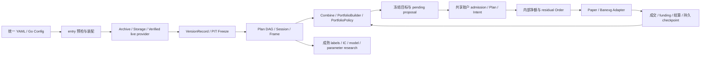

# 统计套利整体 review 与优化记录

范围：统计套利首次引入前的 `f6f0198^` 到 `stat` 当前工作区，包括原有未提交统计工具、source-event、期权与终止结算。开始时 HEAD 为 `b3e6539`，main 为 `df7fa36`（beta.9）；原始工作区已备份并提交，beta.9 已合入，避免回退 WAL、target-step 和不完整快照修复。

## 判断原则

研究回答“可见证据支持什么结论”，组合回答“本策略希望持有什么”，账户回答“可以提交什么以及已经发生什么”。三者分别拥有训练产物、策略状态和真实账本。精确现金/数量由 execution 负责；数值统计不拥有时钟、账户或交易所。数据始终以 `DataSeries.Values map[string]any` 传递，保留类型、NULL 与缺失语义。

优化优先级：先修复守恒、可见性和风险错误，再修复配置与实例生命周期，最后只抽取有两个真实调用方且合同相同的重复逻辑。不为外观统一合并 weights 与 events 账本，不把独立跨场所研究模拟器宣称为生产多交易所执行服务。

## 按证据排序的结论

| 优先级 | 结论 | 证据与置信度 |
| --- | --- | --- |
| 1 | 精确现金、成本基础及风险预留必须先正确，再讨论接口简化 | 高；[终止重分类回归](../execution/terminal_reclassification_test.go)、[成本基础回归](../execution/paper_cost_basis_test.go)、[carried 风险回归](../execution/carried_risk_test.go)覆盖了原错误及修复结果 |
| 2 | 共享账户事实应由账户层处理一次，策略层只提交观察和目标 | 高；[paper funding](../execution/paper_funding.go)、[真实多策略回归](../factor/runner/shared_funding_test.go)证明重复观察不应按变化后的持仓重新归因 |
| 3 | 纯预检、每 run 状态构造和外部资源装配应有明确顺序 | 高；[factory 注册与准备](../factor/runner/definition.go)、[生命周期回归](../factor/runner/factory_lifecycle_test.go)、[live 入口回归](../entry/factor_factory_live_test.go)证明状态隔离及失败前无资源操作 |
| 4 | 分类采样和研究发布时间属于正确性合同，不能通过类型转换或过滤后校验丢失 | 高；[分组采样回归](../factor/expr/group_sampling_test.go)、[时间因果回归](../factor/research/chronology_test.go)、[IC 幂等回归](../factor/research/ic_idempotency_test.go) |
| 5 | 接口应按输入、所有权和生命周期组织；相似公式不一定值得统一 | 行为差异置信度高，结构取舍为推断；[Weights 兼容回归](../factor/research/weights_compat_test.go)锁定差异，[任务索引](../factor/statistics/README.md)提供调用入口。没有性能基准支持“大规模重构必然更快” |

证据包括实现、先红后绿的专项回归和独立集成复审。保留三次风险验证、独立 weights/events 账本和 CrossVenuePaper 是基于这些合同的架构判断；真实市场表现、容量及外部系统兼容性不由本次软件测试确定。

## 架构流程与支持范围

| 路径 | 当前支持 | 需要显式提供 / 限制 |
| --- | --- | --- |
| 普通 YAML | `research`、`backtest --mode weights\|events`、`trade`，factor 与 mixed | 单一统一加载器；不同执行能力需要前置校验 |
| 因子计算 | 原生 Go definition、受限表达式、时序/截面/分组、跨周期 as-of、共享计算 | 分类数据原始类型保留；完整快照与可见性不能为了“可运行”放宽 |
| 组合 | builder、每 run factory、有状态 policy；Full/Patch、权重/绝对数量、生命周期和批次 | checkpoint 接纳原子化；policy 不能直接发送订单 |
| 研究 | 多 horizon、成熟 IC、线性/森林产物、参数实验、风险优化、数值统计工具 | 无自动线上训练、自动显著性阈值或自动真实逐批 PnL |
| Source-event | 历史 Research/Weights/Events；真实闭合源记录驱动决策 | 显式源/周期、零 delay；完整横截面；同批多个 grid 拒绝；live 不支持 |
| Weights | 保留数量的简化浮点账本、显式报价/成本、永久 terminal cash close | 不支持现金期权执行；不是真实账户账本 |
| Events / paper | 单账户多策略、精确数量/现金、内部净额、成交模型、恢复诊断 | 不模拟流动性队列/网络失败；既存 paper store 不是安全重启快照 |
| Cash European option | paper Events 中权利金、显式 bounded stress collateral、现金到期结算 | 无提前行权/实物交割；Banexg live 拒绝；研究价格模型不等于执行支持 |
| CrossVenuePaper | 预置两地现货资金、顺序双腿与显式延迟转账研究模型 | 独立于单账户协调器；无多交易所实盘/分布式原子提交 |
| Live | 有证据的当前 provider、真实时钟、启动对账、账户统一执行 | linear perpetual；没有证据不能配置成“已验证”；live history-IC 拒绝 |
| Storage/PIT | 任意 DataSeries Values；immutable archive 或 attested version pages 可 strict PIT | latest-value SQL 只能显式 static approximation，不能恢复历史修订 |

三路独立 review 发现 14 项代码问题/候选与一项文档组织改进。未把“数值工具多”“不同书籍模型相似”本身当作重复代码缺陷。优先保留当前账户权威、不可变目标、推断与标签隔离、Stop/Join 和共享 session 生命周期；新增能力应通过现有入口和内部窄函数组织。

## 修改前计划

每项由新的独立 agent 评估和执行；先加入能证明缺陷的回归，再进行最小修复。不同 agent 仅修改明确归属文件；同目录冲突依次执行。表中状态随最终验收更新。

| 项目 | 问题与目标 | 回归验收 | 状态 |
| --- | --- | --- | --- |
| E1 | 终止结算补齐 actual/virtual 历史成本差的 PnL 重分类，保持现金守恒 | internal cross 后 terminal，memory/SQLite、重复结算 | 已修复，12 场景专项通过 |
| E2 | carried exposure 不按绝对数量猜测期权风险，集中按 collateral/gross 保守预留 | long→short、short→long、小数量高义务、未成交减仓 | 已修复，四组专项通过 |
| E3 | Paper 与 Store 复用精确成本基础和持仓变更规则 | 非整除均价、部分平仓、反转、terminal、溢出不变更状态 | 已修复，四组逐笔现金一致专项通过 |
| E4 | terminal 检查意图时同时考虑 plan 的有效期 | 过期旧计划取消可结算、Unknown 仍阻止；intent 较短有效期边界 | 已修复，SQLite/Memory 16 场景专项通过，Unknown/Sending/CancelPending 独立阻挡 |
| R1 | shared paper funding 在账户事实层处理一次，重放仍校验原始内容 | 多策略同批 funding 与成交、修订冲突、重复事件 | 已修复，三个存储后端真实 RunMany 红→绿 |
| R2 | shared paper account 校验成交模型一致，拒绝静默覆盖；先校验全部账户的已知模型并将空值按 midpoint 比较，再进入资源构造 | 不同模型拒绝、默认模型等价、构造前拒绝，factory 零调用且无目录残留，兼容模型共享 adapter | 已修复，8 组专项场景通过 |
| R3 | 预检不创建并丢弃 stateful portfolio factory 实例 | 预检无构造、每 run 独立、错误校验与旧 builder 兼容 | 已修复；live 也在目录、funding/transport 验证前构造，真实入口回归通过，独立复审关闭遗漏 |
| I1 | YAML 校验、解码、装配同步新增 clock/settlement/fill 能力 | 正常 YAML、账户覆盖、未知/无效配置、不支持模式拒绝 | 已修复，自定义 event 源实际产生八次决策 |
| F1 | 分组表达式保留分类字段 sampling/availability/max-age 合同 | plan hash、Inputs、过期数据、字符串分类、batch/session | 已修复，factor/expr 全套通过 |
| F2 | 研究参数观察、IC 和已解析标签验证结束/成熟与发布的因果顺序 | 提前发布拒绝、成熟边界和延迟发布、未来样本隔离、未解析标签合同 | 已修复，3 组专项及 research 全套通过 |
| F3 | IC sample 重放不由 NaN 的结构相等破坏幂等性 | 有效 IC/无效 RankIC 重放、内容冲突、历史容量、失败不推进游标 | 已修复，NaN/原因/冲突专项通过 |
| F4 | 相关/协方差数值缩放和有限性验证，避免溢出变成有效零相关 | 大小尺度不变性、常数、不可表示协方差 | 已修复，research 全套与数值专项通过 |
| F5 | 旧 Weights API 是否可以窄适配 QualityWeights，删除重复 | 正负/零均值、空列/重复列、时钟与可见性兼容 | 已独立评估并锁定回归；暂缓合并，避免新增兼容分支 |
| F6 | 线性模型参数拒绝第二个尾随 JSON 文档 | 单文档、未知字段、空参数、尾随对象/数字 | 已修复，先红后绿，research 全套通过 |
| D1 | 数值研究主题索引与端到端调用指南，明确 CLI/Go/实盘范围 | 文档与实际符号一致、本地链接有效 | 已完成；Go 示例编译运行、53 个真实 API 声明及 59 条本地文件链接验证通过 |

## 验证与发布计划

先专项回归，再正式包测试、vet、gofmt、diff 检查、Windows/Linux 构建。发布必须设置 `GOWORK=off`，只使用 go.mod 中已发布依赖。`tmp/legacy-dualma-replay` 为本机临时实验且依赖不在 go.mod；不得为它新增生产依赖。最终记录临时包与外部数据库/交易所验收边界，不以单元测试推断实盘能力。

确认 main 工作树干净后合并，经测试的源码提交更新 `core.Version`、创建新 beta tag，并创建 GitHub prerelease。若未修改 web/ui，沿用原 UIVersion。

## 最终验收

- 15 项候选全部完成独立评估：13 项代码修复/结构优化及 1 项文档组织改进落地；F5 保留公开合同，仅增加兼容回归。
- 独立集成复审发现的 live factory 顺序遗漏已修复并补真实入口回归；复审结论为 APPROVE，无剩余确定的发布阻断。
- `GOWORK=off` 下串行执行 35 个正式 Go 包测试通过；execution、entry、runner 另有不使用缓存的完整包验证。全正式包 `go vet`、`go mod verify`、gofmt 与 `git diff --check` 通过。
- Windows/Linux amd64 主程序构建通过；Windows `--version` 输出 `banbot v0.6.0-beta.10`，research/backtest/trade 帮助入口通过。发布资产从 main 的最终提交构建，并提供 SHA256 校验和。
- VitePress 文档站构建通过；指南 Go 示例编译执行，53 个 API 声明核对通过，含本报告的 5 篇改动文档共 72 条本地文件链接存在。链接 fragment anchors 未逐个验证。
- 正式包排除 `tmp/`、`node_modules/` 等非发布目录；本机 `tmp/legacy-dualma-replay` 依赖不在 go.mod，不为临时实验改变生产依赖。并行启动多个 execution 测试进程会争抢既有 sender lease，最终验收仅串行运行，未削弱该保护。
- 当前环境无 CGO 工具链，未运行 race；未做真实 QuestDB、交易所或真实历史数据的集成验收。全仓文档链接脚本另有 3 个既有 `UI_refact.md` 路径解析误报，新增链接已独立验证。
- 发布版本为 `v0.6.0-beta.10`；未修改前端源码，`UIVersion` 与 `dist.zip` 沿用 `v0.6.0-beta.5`。本地原有 `go.work.sum` 修改保留，未纳入发布提交；生产构建不使用邻接开发仓库。

## 已确认的架构取舍

- 风险计算保留单品种协调、全账户准备、发送前验证三个调用时机。它们分别依赖当前报价、冻结多品种证据、发送时账本与有效期，不能简单合并并删除检查。本次仅把共同的 carried 风险估值集中：gross 与 collateral 独立比较，不用绝对数量或单一“最大持仓”推断所有风险。
- 旧 Go `GroupDemean/GroupZScore` 的无限期 latest 分类合同保留；显式 Field/AsOfField 和表达式绑定通过 `GroupDemeanByField/GroupZScoreByField` 保留完整采样声明。分组仍读取原始字符串等字段，不进入 Numeric 依赖。旧 Go 计划 hash 因明确标记 latest 合同更新，旧运行状态/manifest 身份不能假定不变。
- Paper 与 Store 的成本基础规则有同一经济含义与两个真实调用方，值得复用；crossvenue 与 single-account、weights 与精确 ledger 不满足这一条件，保留独立模型。
- `RegisterPortfolioFactory(name, factory, validator...)` 可提供纯参数检查；预检只验证注册、身份及 validator。旧工厂不提供 validator 时，构造错误在实际装配前通过 `PreparePortfolioConfig` 检查，纯预检不能执行构造来猜测参数是否有效。运行配置与实例均为该次运行私有，不能把 prepared builder 当作跨运行可重用配置。
- shared funding 原始 fact 存入既有事件存储，由账户 gate 在一事务内冻结归因与更新账本；保留 Funding ledger/strategy totals 语义，不用无界 sink 缓存。相同 rate/mark/instrument/事件时间重放是幂等，内容修订仍拒绝，冷历史和归档失败回滚有回归。
- 旧 `ICHistory.Weights` 与 `QualityWeights` 的验证与浮点运算合同不同：前者接受空/重复/未知列，且 sum/count 与后者在线均值在 `[.1, .3, -.4]` 的零均值边界有不同 readiness。强行包装会改变公开结果；保留两段短实现并增加兼容测试，比引入兼容开关或双均值状态更简单。
- 相关和协方差用二次幂缩放改善数值稳定性；不能表示的非零协方差明确报错，不宣称资产无风险。协方差归一化副本增加 `O(samples × assets)` 临时内存，原时间复杂度不变；未声称已取得全量性能收益。
